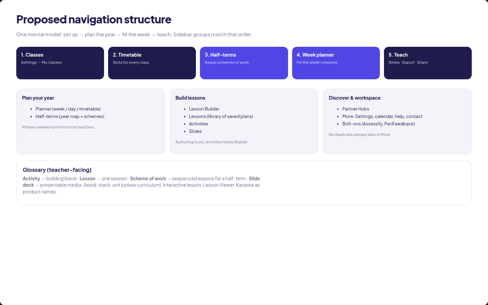

# CCDesigner / Studio Score — UX audit (19 Oct 2026)

Audit only of `preview/oct19-audit` (Vite app in `artifacts/ccd`). Walked every sidebar destination and More tools at **1440×900** as Demo Visitor after prototype unlock. Screenshots live in `screenshots/`; ranked suggestions with BEFORE/AFTER pairs in `images/`.

**Note:** Other agents are still finishing timetable class side panel, week-planner outline slots from the timetable, Music Hubs region colouring, activity-card year-group pills / class-filtered Activity Library, and the local forum API (forum 404s locally). Those are mentioned only briefly below.

---

## Summary

The redesign is visually coherent — navy sidebar, indigo accent, Plus Jakarta Sans, white rounded surfaces — and the primary labels (**Planner**, **Half-terms**, **Slides**) mostly match what teachers see. The biggest risks are **information architecture**, not polish:

1. **Half-term planning has three homes** (sidebar Half-terms, Planner → Units, Planner → Half-terms sub-tab).
2. **Class context disappears** on Planner / Slides / Partner Hubs / More tools, while Settings copy still says “pick a class in the header.”
3. **More tools re-lists** Lessons, Slides, Half-terms and Timetable, competing with the sidebar.
4. **Lessons rows** expose six brightly coloured actions at once; export also surfaces a PDF config toast in local demo.

Teacher journeys (classes → timetable → half-term schemes → week planner → activities/lessons → slides → share) are all reachable, but the path is easy to lose because of duplicated entry points and mismatched section eyebrows (`YOUR TEACHING`, `PLAN & PROGRESS`, `CONNECT & CREATE`, `WORKSPACE`).

Visible naming leftovers of “Interactive lesson / Lesson Viewer / Karaoke / preview mode” were **not** found on the main surfaces in this walk. Remaining terminology friction is **Units vs Half-terms**, **Schedule vs Planner**, **scheme / unit / lesson stack**, and breadcrumb section names.

---

## Ranked suggestions

### Critical

#### 1. Make class context unmistakable — and consistent
- **Problem:** The header class selector only appears on Lesson Builder, Lessons, Activity Library and Half-terms. Planner (all-classes week), Slides, Partner Hubs and More tools hide it. Teachers can switch class for Activities, then jump to Planner or Slides and lose the sense of “which class am I in?” Settings still says “pick a class in the header.”
- **Why it matters:** Almost every teacher task is class-scoped. Silent context loss causes wrong libraries, wrong assigns, and distrust.
- **Recommendation:** Always show a header chip. On Planner week use an explicit **All classes / One class** control. When “One class” is on, keep the same chip everywhere. Align Settings copy with reality.
- **Effort:** M
- **Images:** [01-before](images/01-before.png) · [01-after](images/01-after.png)

#### 2. One home for half-term planning (kill Planner “Units” as a parallel IA)
- **Problem:** Sidebar **Half-terms** is the year map. Planner also has **Units** (and nested Half-terms / Progress tabs) titled “Lower Kindergarten Music · half-terms.” Same job, two mental models, different chrome.
- **Why it matters:** Schemes of work are the spine of term planning. Duplicate homes mean teachers ask “where do I assign a scheme?” and get uneven answers.
- **Recommendation:** Half-terms owns year map + assign scheme + single-class focus + progress. Planner keeps **Schedule** + **Timetable** only. Link “All year groups” / “Open half-terms” instead of embedding a third room.
- **Effort:** L
- **Images:** [02-before](images/02-before.png) · [02-after](images/02-after.png) · structure: [00-sitemap](images/00-sitemap.png)

### High

#### 3. Calm the Lessons list actions
- **Problem:** Each lesson row shows six saturated buttons (Copy Link, Assign, Copy, To Year, Edit, Delete). Scan cost is high; primary intent (“open / teach this”) is unclear. Local demo also toast-errors PDF config on this screen.
- **Why it matters:** Lessons is the share/export hub. Cognitive load here slows the end of every planning cycle.
- **Recommendation:** Primary **Open** + secondary **Assign**; put Copy link / Duplicate / Move / Edit / Export PDF / Delete in an overflow menu. Soften destructive colour until confirm.
- **Effort:** S
- **Images:** [03-before](images/03-before.png) · [03-after](images/03-after.png)

#### 4. Slim More tools — stop duplicating the sidebar
- **Problem:** More tools lists Lessons, Slides, Half-terms and Timetable builder again, plus Settings / Forum / Help. Teachers get two “sources of truth” for navigation.
- **Why it matters:** Redundant destinations train people to hunt in the wrong place and weaken the sidebar as the map of the product.
- **Recommendation:** Keep Settings, Class calendar, Forum, Contact, Help, Walkthrough. Drop cards that already have primary nav. Point Timetable only from Planner.
- **Effort:** S
- **Images:** [04-before](images/04-before.png) · [04-after](images/04-after.png)

#### 5. Align eyebrows / section labels with the sidebar
- **Problem:** Sidebar sections are **Connect & create** / **Your tools**. Page eyebrows say `YOUR TEACHING`, `PLAN & PROGRESS`, `WORKSPACE`, `CONNECT & CREATE` interchangeably (e.g. Half-term map = `PLAN & PROGRESS / TERM VIEW`).
- **Why it matters:** “Where am I?” fails the brand-of-place test when the chrome contradicts the nav taxonomy.
- **Recommendation:** One taxonomy only: `CONNECT & CREATE / {Page}` and `YOUR TOOLS / {Page}`. Rename “TERM VIEW” to **Half-terms** / **Year map**.
- **Effort:** S
- **Images:** [05-before](images/05-before.png) · [05-after](images/05-after.png)

### Medium

#### 6. Landing: one decision at a time
- **Problem:** Welcome/partners modal stacks on top of the login card (“Continue to sign in” while Sign in is already visible). Prototype gate is a third step.
- **Why it matters:** First impression for funders and teachers feels busy and procedural.
- **Recommendation:** Login card as the single panel; walkthrough + prototype entry as secondary actions on that card (or a sequential sheet, not a competing modal).
- **Effort:** S
- **Images:** [06-before](images/06-before.png) · [06-after](images/06-after.png)

#### 7. Unify primary CTAs (Activity Library yellow Create)
- **Problem:** Activity Library uses a bright yellow **+ Create** while the rest of the product uses indigo primaries (and yellow is also used for “Today”, “Draft”, “Copy term”).
- **Why it matters:** Yellow stops meaning “attention” when it also means “primary create.”
- **Recommendation:** Indigo for create actions; reserve amber for status/attention only.
- **Effort:** S
- **Images:** [07-before](images/07-before.png) · [07-after](images/07-after.png)

#### 8. Slides: library-first for returning teachers
- **Problem:** Slides opens with a large marketing hero (“Slides that fill the room”) before the library. Fine once; noisy every visit. Feature pills compete with **+ New slides**.
- **Why it matters:** Teachers usually want Play/Edit on an existing deck in under two clicks before a lesson.
- **Recommendation:** Title + short lede + New slides + library. Move capability list beside or below the grid (first-run tip only).
- **Effort:** S
- **Images:** [08-before](images/08-before.png) · [08-after](images/08-after.png)

### Nice-to-have

#### 9. Lesson Builder empty state discoverability
- **Problem:** Copy says “Drag activities into a lesson,” but the left rail shows collapsed category rows until expanded — easy to miss the first activity.
- **Recommendation:** Expand the first category by default, or show 3–5 starter chips above the list for the selected class.
- **Effort:** S
- **Screenshot:** [06-lesson-builder](screenshots/06-lesson-builder.png)

#### 10. Class calendar naming under Planner
- **Problem:** Opened from More tools into Planner chrome with **Schedule** still highlighted while the title says Class calendar — three names for adjacent concepts.
- **Recommendation:** Treat Class calendar as a Schedule sub-view with matching tab state, or rename Schedule → **Week** and keep Calendar as a peer under Planner.
- **Effort:** S
- **Screenshot:** [13-class-calendar](screenshots/13-class-calendar.png)

#### 11. Scheme / unit / lesson stack glossary
- **Problem:** Assign panel says “scheme of work (unit / lesson stack).” Lessons page says “Lesson Stacks / Units.”
- **Recommendation:** Pick one teacher-facing term (**Scheme** recommended) and use it in UI copy; keep “stack” as an internal/admin synonym if needed.
- **Effort:** S
- **Screenshot:** [05d-half-term-empty-or-assign](screenshots/05d-half-term-empty-or-assign.png)

#### 12. Bolt-ons badge always “2”
- **Problem:** Persistent red **2** implies unread urgency for catalogue products.
- **Recommendation:** Badge only for new/unseen bolt-ons, or drop the count until something needs attention.
- **Effort:** S
- **Screenshot:** [14-bolt-ons](screenshots/14-bolt-ons.png)

---

## Journey & IA diagram

Proposed nav + setup→plan→teach→share journey:

---

## Walk notes (by area)

| Area | Verdict |
|------|---------|
| Login / landing | Strong brand; modal stacks on login (see #6). Prototype password gate OK for funding builds. |
| Planner week / day / month | Clear week board; day view solid. No class chip (see #1). Schedule / Timetable / Units triad — Units overlaps Half-terms (#2). |
| Timetable builder | Clear all-classes grid; empty in demo vs populated week planner (agents finishing slot sync — watch coupling). |
| Half-terms map + assign | Strong year map; assign scheme empty state is good. Triple naming scheme/unit/stack (#11). |
| Lesson Builder | Clear split pane; empty drag affordance weak (#9). |
| Lessons | Content OK; action density and PDF toast (#3). |
| Activity Library + editor | Class banner is excellent; yellow Create (#7). Full-page editor is clear and on-brand. |
| Slides landing / library / editor | Naming fixed to Slides. Hero-heavy landing (#8). Editor is powerful and dense (acceptable for power tool). |
| Partner Hubs map → region → hub | Clear section tabs; London region + hub page readable. Region colouring still in flight. |
| Arts organisations / Paid resources | Reachable; browse pattern fine. |
| More tools | Useful leftovers buried under duplicates (#4). |
| Settings / My classes | Solid; copy vs missing header chip elsewhere (#1). |
| Class calendar | Works; naming/tab state fuzzy (#10). |
| Bolt-ons | Catalogue clear; badge noise (#12). |
| Forum | Empty + **404** locally (API in progress). |
| Export PDF / Copy Link | Reachable from Lessons; PDF needs server key in this environment. |

### Console / broken UI
- Forum: `Request failed (404)`.
- Lessons: toast — `PDF generation is not configured on this server. Set PDFBOLT_API_KEY.`
- No leftover **Interactive lesson / Lesson Viewer / Karaoke / preview mode** copy on walked primary surfaces.

---

## Image index

| File | What |
|------|------|
| `images/00-sitemap.png` | Proposed nav + journey |
| `images/01-before.png` / `01-after.png` | Persistent class context on Planner |
| `images/02-before.png` / `02-after.png` | Half-terms owns year planning |
| `images/03-before.png` / `03-after.png` | Lessons actions simplified |
| `images/04-before.png` / `04-after.png` | More tools slimmed |
| `images/05-before.png` / `05-after.png` | Eyebrow / section taxonomy |
| `images/06-before.png` / `06-after.png` | Landing single decision |
| `images/07-before.png` / `07-after.png` | Indigo Create on Activity Library |
| `images/08-before.png` / `08-after.png` | Slides library-first |
| `screenshots/*` | Full walk capture set |

Mockup source: `mockups/afters.html`. Capture scripts: `scripts/`.
